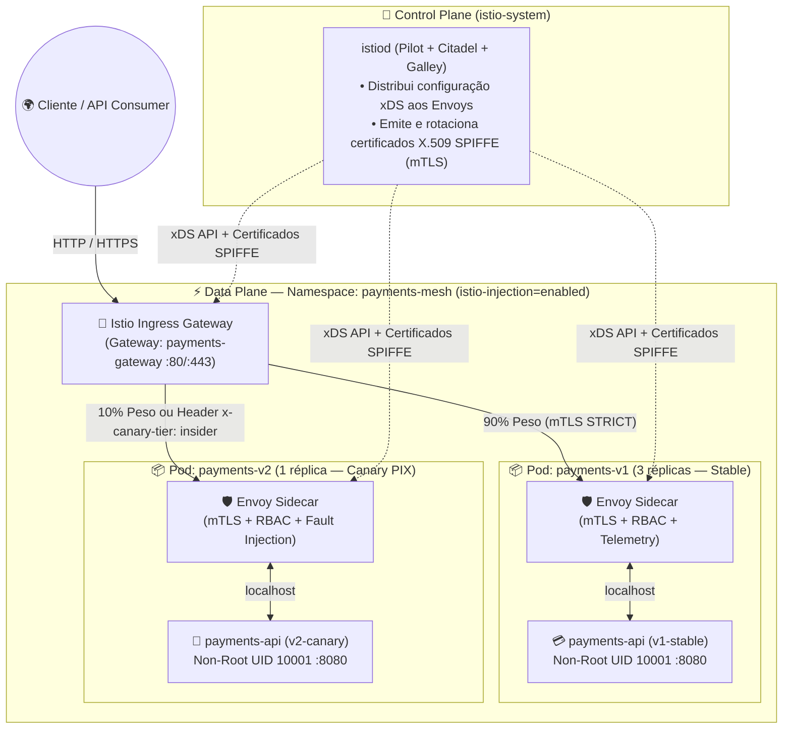
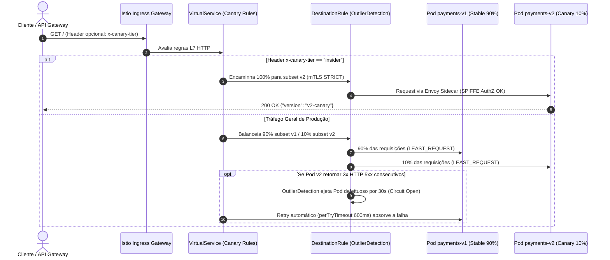

<div align="center">

# 🕸️ Acelera DevOps — Istio Service Mesh Reference Lab on Kubernetes

[](https://istio.io/)
[](https://istio.io/latest/docs/concepts/security/)
[](https://istio.io/latest/docs/concepts/traffic-management/)
[](https://github.com/Acelera-DevOps/istio-lab/actions)

**Laboratório de referência Production-Grade para Gerenciamento de Tráfego L7, Segurança Zero-Trust (mTLS Estrito + SPIFFE RBAC), Resiliência (Circuit Breaking & Retries) e Engenharia de Caos no Kubernetes com Istio Service Mesh.**

Desenvolvido por **[Erik Tonon](https://github.com/eriktonon)** — *Head of Platform Engineering & GenAI @ IBM Consulting | Acelera DevOps*.

</div>

---

## 🎯 Por Que uma Service Mesh?

Em arquiteturas de microsserviços distribuídas, embutir bibliotecas de *retry*, *circuit breaking*, *service discovery*, *mTLS* e telemetria dentro do código de cada aplicação (Java, Go, Node.js, Rust, Python) cria **alto acoplamento operacional** e inconsistência entre times.

O **Istio Service Mesh** desacopla essas preocupações de infraestrutura do código de negócio ao injetar um proxy **Envoy Sidecar** ao lado de cada Pod, coordenado centralmente pelo Control Plane (**`istiod`**):



---

## 🏗️ Capacidades Implementadas nos Manifestos (`manifests/`)

| Manifesto | Recurso Kubernetes / Istio | Capacidade de Engenharia de Plataforma & SRE |
| :--- | :--- | :--- |
| **[`00-namespace.yaml`](./manifests/00-namespace.yaml)** | `Namespace` (`payments-mesh`) | Habilita injeção automática de sidecar (`istio-injection: enabled`) e aplica **Pod Security Standards (`restricted`)**. |
| **[`01-workloads-v1-v2.yaml`](./manifests/01-workloads-v1-v2.yaml)** | `ServiceAccount`, `Service`, `Deployment` (`v1` & `v2`) | Containers **hardened** rodando como `non-root` (`UID 10001`), `readOnlyRootFilesystem: true`, `capabilities.drop: ["ALL"]`, `seccompProfile: RuntimeDefault` e probes HTTP. |
| **[`02-gateway.yaml`](./manifests/02-gateway.yaml)** | `Gateway` (`networking.istio.io/v1`) | Configura o balanceador de borda `istio-ingressgateway` nas portas `80` (HTTP) e `443` (HTTPS TLS Simple) para `payments.acelera-devops.local`. |
| **[`03-virtualservice-canary.yaml`](./manifests/03-virtualservice-canary.yaml)** | `VirtualService` (`networking.istio.io/v1`) | Implementa **Canary Release `90/10`** (`90% v1` / `10% v2`), roteamento determinístico por header (`x-canary-tier: insider` $\to 100\%\text{ v2}$), `timeout: 2s` e `retries` automáticos (`3x` com `perTryTimeout: 600ms`). |
| **[`04-destinationrule-resilience.yaml`](./manifests/04-destinationrule-resilience.yaml)** | `DestinationRule` (`networking.istio.io/v1`) | Define `subsets` (`v1`/`v2`), algoritmo `LEAST_REQUEST`, limites de `connectionPool` e **Circuit Breaking (`outlierDetection`)** ejetando pods após 3 erros `5xx` consecutivos por `30s`. |
| **[`05-security-mtls-rbac.yaml`](./manifests/05-security-mtls-rbac.yaml)** | `PeerAuthentication` + `AuthorizationPolicy` | Força criptografia mútua **`STRICT` mTLS** em todo o namespace e restringe o acesso L7 apenas às identidades **SPIFFE** autorizadas (`payments-sa` e `istio-ingressgateway`) nos métodos `GET`/`POST`. |
| **[`06-chaos-fault-injection.yaml`](./manifests/06-chaos-fault-injection.yaml)** | `VirtualService` (Perfil de Caos) | Injeta **5% de falhas HTTP `503`** (`fault.abort`) e **2 segundos de atraso fixo em 10% do tráfego** (`fault.delay`) para validar se os *timeouts*, *retries* e *circuit breakers* protegem o cliente. |

---

## 🔄 Fluxo de Progressive Delivery (Canary) & Circuit Breaking



---

## 🚀 Guia Prático Passo a Passo (Hands-On Exercises)

### Pré-requisitos
- Cluster Kubernetes (`kind`, `minikube`, `k3s`, `EKS`, `AKS` ou `GKE`)
- Istio `1.20+` instalado (`istioctl install --set profile=demo -y`)

### Exercício 1 — Subir a Malha Segura e o Canary 90/10

```bash
# Aplicar namespace, deployments, gateway, virtualservice, destinationrule e mTLS STRICT
make apply

# Verificar status dos Pods (note 2/2 containers em cada Pod: app + istio-proxy)
make status
```

### Exercício 2 — Validar o Split de Tráfego 90/10 e o Roteamento por Header

```bash
# Executar a bateria automatizada de testes (20 requisições gerais + teste de header insider)
make verify
```

Você verá aproximadamente **18 respostas da `v1-stable`** e **2 respostas da `v2-canary`**, seguidas por **100% de roteamento para `v2-canary`** quando o cabeçalho `x-canary-tier: insider` é enviado.

### Exercício 3 — Engenharia de Caos: Injeção de Falhas HTTP 503 e Latência

```bash
# Ativar o perfil de Chaos Engineering (5% HTTP 503 abort + 10% 2s delay com timeout de 1.5s)
make chaos-enable

# Observar o comportamento dos retries e timeouts no Envoy
kubectl logs -n payments-mesh -l app=payments-service -c istio-proxy --tail=30

# Restaurar a operação normal da malha
make chaos-disable
```

### Exercício 4 — Limpeza do Ambiente

```bash
make clean
```

---

## 📂 Estrutura do Repositório

```text
istio-lab/
├── .github/workflows/ci.yml                         # Validação sintática de todos os manifestos YAML e scripts Bash
├── manifests/
│   ├── 00-namespace.yaml                            # Namespace payments-mesh com istio-injection=enabled e PSS restricted
│   ├── 01-workloads-v1-v2.yaml                      # ServiceAccount, Service e Deployments hardened (v1-stable e v2-canary)
│   ├── 02-gateway.yaml                              # Istio Ingress Gateway HTTP/HTTPS
│   ├── 03-virtualservice-canary.yaml                # Canary 90/10 + Header routing + Timeouts & Retries
│   ├── 04-destinationrule-resilience.yaml           # Subsets, LEAST_REQUEST, ConnectionPool e OutlierDetection Circuit Breaker
│   ├── 05-security-mtls-rbac.yaml                   # PeerAuthentication STRICT mTLS + AuthorizationPolicy Zero-Trust SPIFFE
│   └── 06-chaos-fault-injection.yaml                # Fault Injection (HTTP 503 Abort + Latency Delay)
├── scripts/
│   └── verify-mesh.sh                               # Script automatizado de verificação de mTLS, Canary e Header Routing
├── LICENSE                                          # Licença Apache 2.0
├── Makefile                                         # Automação (apply, chaos-enable, chaos-disable, verify, status, clean)
└── README.md                                        # Documentação arquitetural e roteiro de laboratório
```

---

## 📄 Licença

Distribuído sob a licença **Apache 2.0**. Veja [`LICENSE`](./LICENSE) para mais detalhes.
